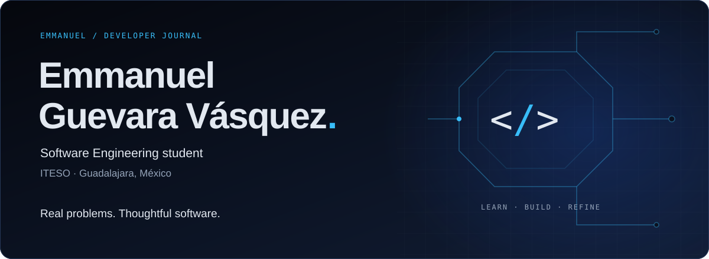
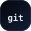
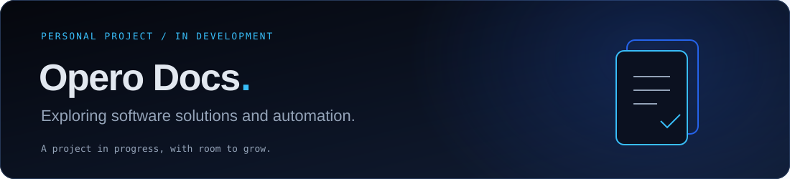

<picture>
  <source media="(max-width: 600px)" srcset="assets/header-mobile.svg">
  
</picture>

  <a href="#user-content-about">About</a> ·
  <a href="#user-content-toolbox">Toolbox</a> ·
  <a href="#user-content-work">Work</a> ·
  <a href="#user-content-activity">Activity</a> ·
  <a href="#user-content-connect">Connect</a>

## About

I'm **Emmanuel Guevara Vásquez**, a Software Engineering student at **ITESO** in Guadalajara, México. I work on academic and personal projects, learning to turn real needs into useful software.

I'm interested in **systems architecture, automation, AI, databases, APIs and cybersecurity**. My goal is to build applications that are clear to maintain, secure by design and able to grow with their users. I'm developing these skills one project at a time.

**Estudiante de Ingeniería en Desarrollo de Software · Curiosidad técnica, aprendizaje continuo y atención al detalle.**

## Toolbox

Tools I'm using and learning through project work:

  
  
  
  
  
  

**Project practice** · Python, TypeScript, JavaScript and SQL.

**Frameworks & databases I'm learning through projects** · React, Next.js, Vue, FastAPI, SQLite and PostgreSQL.

**Development tools** · Git, GitHub and macOS.

**Academic foundations** · Java and object-oriented programming; C and data structures.

  
  

AI, automation and cybersecurity are areas I'm exploring as I strengthen my software engineering foundations.

## Work in progress

<picture>
  <source media="(max-width: 600px)" srcset="assets/opero-docs-mobile.svg">
  
</picture>

**Opero Docs** is one of my personal projects, focused on software solutions and automation. It is **in development**. Implementation details and source code remain private.

Alongside my personal projects, I'm studying **object-oriented programming in Java** and **data structures in C** through academic exercises.

## Public activity

[Explore public repositories](https://github.com/gvemmanuel3712-cyber?tab=repositories) · [View contributions on GitHub](https://github.com/gvemmanuel3712-cyber?tab=overview)

The contribution graph on my profile is the reference for my GitHub activity. Public repositories reflect only the work I've chosen to share; activity and language totals are not measures of proficiency.

## Connect

Interested in software engineering, practical automation or learning together?

[Find me on GitHub →](https://github.com/gvemmanuel3712-cyber)

---

Guadalajara, México · Learn with intent. Build with care.

