<picture>
  <source media="(max-width: 600px)" srcset="assets/v2/header-mobile.svg">
  
</picture>

<!-- portfolio-link:start -->

<a href="https://gvemmanuel3712-cyber.github.io/"><strong>Enter my Developer Playground ↗</strong></a>

<!-- portfolio-link:end -->

<picture>
  <source media="(max-width: 600px)" srcset="assets/v2/profile-scan-mobile.svg">
  
</picture>

### Developer toolbox

<picture>
  <source media="(max-width: 600px)" srcset="assets/v2/toolbox-mobile.svg">
  
</picture>

### Selected work

<picture>
  <source media="(max-width: 600px)" srcset="assets/v2/projects-mobile.svg">
  
</picture>

[Profile source ↗](https://github.com/gvemmanuel3712-cyber/gvemmanuel3712-cyber) · [All public work ↗](https://github.com/gvemmanuel3712-cyber?tab=repositories)

### Public signals

<picture>
  <source media="(max-width: 600px)" srcset="assets/v2/contributions-mobile.svg">
  
</picture>

[View current activity on GitHub ↗](https://github.com/gvemmanuel3712-cyber?tab=overview)

About / Sobre mí

I'm **Emmanuel Guevara Vásquez**, a **Software Engineering student at ITESO**, Guadalajara, México. I work on academic and personal projects and I'm interested in architecture, automation, AI, databases, APIs and cybersecurity. My goal is to build useful software that is secure and maintainable.

**Estudiante de Ingeniería en Desarrollo de Software. Curiosidad técnica, aprendizaje continuo y atención al detalle.**

The toolbox separates project practice from academic learning. GitHub contributions are events, not a measure of experience. The calendar is a dated public snapshot; a small scheduled workflow can refresh it. The animation never invents or changes contributions.

Contact: [@gvemmanuel3712-cyber](https://github.com/gvemmanuel3712-cyber).

